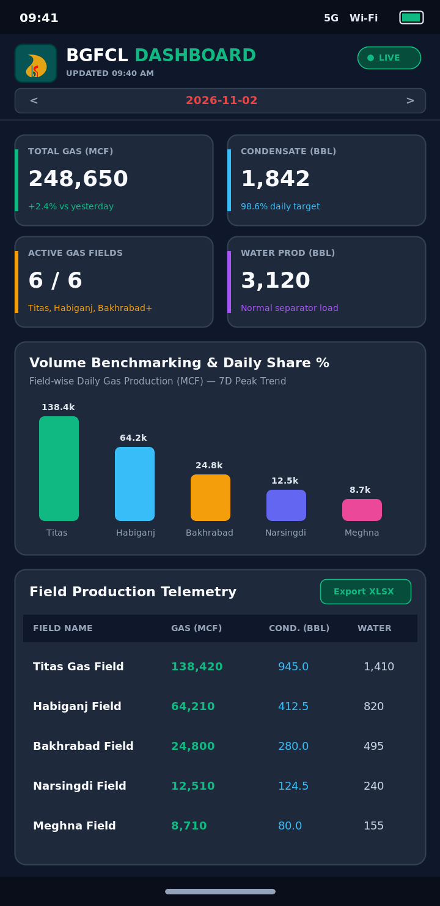

# BGFCL Dashboard (Android)

An Android client application for the **BGFCL Dashboard** (`http://180.211.173.178:3000`), built with Kotlin and Jetpack Compose.

## App Screenshot

<p align="center">
  
</p>

## Features

- **Direct WebView Integration**: Loads `http://180.211.173.178:3000` in a clean, full-screen WebView respecting the phone's default system status bar and navigation bar insets.
- **Official BGFCL Branding**: Uses the official BGFCL logo across adaptive and legacy launcher icons.
- **File Upload Support**: Implements `WebChromeClient.onShowFileChooser` with Android's `ActivityResultContracts` to support single and multi-file uploads (`<input type="file">`).
- **File Download Support**: Integrates Android's `DownloadManager` with cookie preservation, automatic filename/MIME-type resolution, and system download completion notifications.
- **Offline Caching**: Monitors real-time network connectivity via `ConnectivityManager` and dynamically switches between `WebSettings.LOAD_DEFAULT` (online) and `WebSettings.LOAD_CACHE_ELSE_NETWORK` (offline) with DOM storage and database storage enabled.
- **Cleartext HTTP Support**: Configured with `network_security_config.xml` and `usesCleartextTraffic="true"` to allow HTTP communication with `180.211.173.178`.
- **Hardware Back Navigation**: Supports navigating backward through the WebView page history using the device's Back button/gesture.

## Project Structure

- `bgfcl` — Main entry point, file chooser activity result handling, permission requests, and back-stack handling.
- `bgfcl` — Configured `WebView` composable with caching, file upload, and download listeners.
- `bgfcl` — Helper for queuing downloads via `DownloadManager` and resolving filenames/MIME types.
- `bgfcl` — Reactive network connectivity monitor using `ConnectivityManager.NetworkCallback`.
- `app/src/main/res/xml/network_security_config.xml` — Network security configuration enabling cleartext HTTP traffic for the BGFCL server.
- `docs/app_screenshot.png` — Application preview screenshot.

## Requirements & Permissions

- **Minimum SDK**: Android 7.0 (API 24)
- **Target SDK**: Android 16 (API 36)
- **Permissions**:
  - `INTERNET` — Required to load the BGFCL Dashboard web app.
  - `ACCESS_NETWORK_STATE` — Used to detect online/offline status for intelligent WebView cache switching.
  - `POST_NOTIFICATIONS` — Requested on Android 13+ to display file download notifications.

## Building & Running

1. Open the project in **Android Studio** or build via Gradle CLI:
   ```bash
   ./gradlew assembleDebug
   ```
2. Install the generated APK on an Android device or emulator with network access to `http://180.211.173.178:3000`.
3. To run unit and Robolectric tests:
   ```bash
   ./gradlew :app:testDebugUnitTest
   ```
